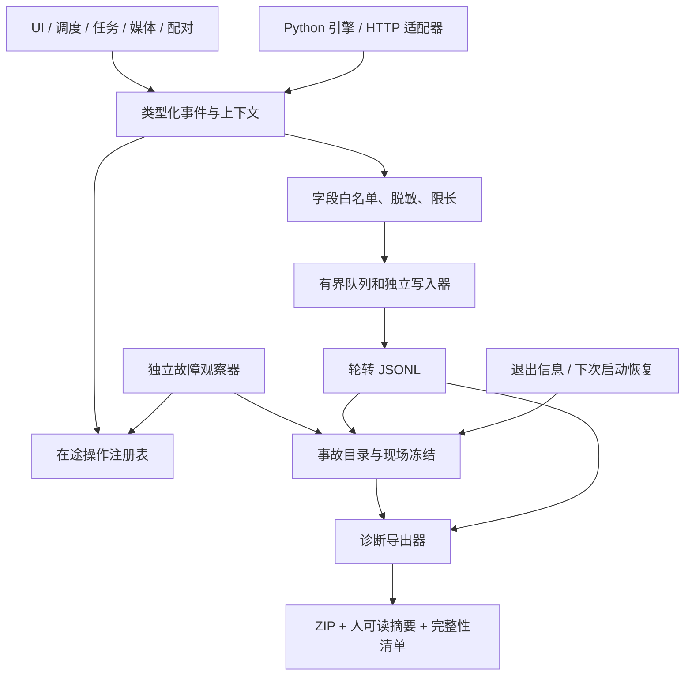

# Android 故障诊断体系设计 v1

日期：2026-11-08。状态：设计提案，尚未实现。范围：Android；iOS、桌面端后续迁移。

实现进展：`1.0.9-beta.5` 已按本次确认的产品约定实现首版日志与导出；下文仍保留完整目标设计。实际覆盖与观测边界见 [IMPLEMENTATION.md](IMPLEMENTATION.md)，不能把目标验收表视为全部已通过。

本设计的目标是让一次用户反馈具备可还原的任务时间线、异常发生时的现场、明确的证据缺口，以及可执行的复现和修复验收。不能承诺每个问题仅凭日志就能确定根因；必须能够区分“已证实”“待验证”和“证据不足”。

产品约定：日志始终开启，不提供关闭、日志等级、保留时长或容量配置。固定保留最多 14 天，应用私有诊断目录总上限固定为 64 MiB（67,108,864 字节），达到任一限制自动滚动覆盖。设置中只提供“导出日志”按钮和说明，不增加录制、增强诊断或手动清理入口。导出同时包含标准 JSONL 和从同一数据生成的控制台风格 readable.log。文件名允许保留，照片本体、账号原文和认证秘密禁止进入日志。

配套文件：

- [故障处理与验收流程](RUNBOOK.md)：用户操作、研发排查、故障注入与实施里程碑。
- [事件数据契约](event.schema.json)：事件信封的 JSON Schema，事件专属字段仍需注册表校验。
- [示例时间线](example-upload-stall.jsonl)：虚构的上传阻塞现场，仅用于说明，绝非 Issue #2 实测结论。

## 1. 现状与边界

代码审计基线：Android `3bcabe8`；参考 iOS `0d95a07`、桌面端 `598eeeb`，均为本地检出版本。

| 现有位置 | 已有能力 | 定位缺口 |
| --- | --- | --- |
| `HarborViewModel.report()` | 版本、设备、任务状态和错误码汇总 | 没有事件顺序、每次尝试、在途请求及重启前现场 |
| `Engine.call()` | Kotlin/Python 桥接、错误码与部分 metrics | catch 丢失异常上下文；跨语言调用没有统一关联 ID |
| `gpmc/mobile.py` | 进度回调、阶段统计、重试、内容锁、生命周期锁 | metrics 主要在调用返回时交付，卡死时拿不到；等待锁、网络子阶段未完整记录 |
| `BackupRepository` | 持久任务、并发名额、暂停与恢复 | 缺少谁占名额、谁在等、请求是否真正退出的证据 |
| `Scheduler` | UIDT、WorkManager、未启动兜底 | 缺少提交、系统接受、实际启动、停止、兜底竞争的统一时间线 |
| `MediaRepository` / `SourceBridge` | MediaStore、SAF、FD 或临时文件 | 缺少文件提供方、读取等待、临时文件及 FD 释放证据 |
| `CleanupRepository` / `ComputerLink` | 核验、系统删除授权、配对和传输状态 | 缺少核验证据链、删除边界、对端确认及超时现场 |

iOS 已有阶段租约、恢复预算和后台回执，可作为后续共同语义的参考；不要求 Android 本次改写成 iOS 的执行模型。

本次不改上传行为，不自动重试、不自动杀线程、不接入远程收集服务。先让证据完整，再单独设计和验证恢复行为。

## 2. 架构：事件、快照、事故、证据包



四类证据各司其职：

1. **事件日志**：重要行为、阶段开始/结束、请求尝试、等待与取消。
2. **运行快照**：在途任务、占用名额、锁等待、最近真实进展、调度和资源状态。
3. **事故记录**：异常触发点及前后窗口、重复快照、有限栈信息，独立保留。
4. **持久检查点**：任务真实状态与副作用确认情况。诊断日志不是恢复数据库，不得根据一条日志决定重传或删除。

第一版使用应用私有目录 `noBackupFilesDir/diagnostics/`，不随系统云备份迁移。系统 Logcat 只作可选镜像，不作为唯一持久证据。写入器和导出器均不能依赖上传线程、Python GIL、业务 Mutex 或 Room 事务才能输出基本现场。

## 3. 关联 ID 与时钟

| 字段 | 生命周期和规则 |
| --- | --- |
| `session_id` | 每次进程启动随机生成；不能用 PID 或账号替代 |
| `producer_id` | 同一会话内的事件源，如 `kotlin-main`、`python-engine`；标明实际进程和运行时 |
| `seq` | 每 producer 单调递增，在进入缓冲前分配；丢弃也占序号，便于检测缺口 |
| `event_id` | `session_id + producer_id + seq` 唯一；跨桥转发不得当作新事件重复记录 |
| `job_id` / `item_id` | 使用现有随机任务 ID；同一个逻辑任务重启后保持，文件路径不作 ID |
| `resource_id` | 每个照片/视频资源随机 ID；Live Photo 两半归同一逻辑项目 |
| `run_id` | 调度器每次实际执行生成；区分同任务被重复唤醒 |
| `attempt_id` | 每次项目执行尝试生成，重试必须更换；独立记录尝试序号 |
| `trace_id` / `span_id` | 任务/操作的因果关系；32/16 位小写十六进制且非全零；一个 span 对应一个具体操作 |
| `request_id` | 每次 HTTP 交换生成，不能把上传 token 当 ID |
| `incident_id` / `bundle_id` | 一次故障现场 / 一次导出的随机 ID；供用户反馈引用 |

`job_id` 跨重启保持；新进程创建新 root span，并通过 link 关联前次执行，不能让一个 span 跨进程假装连续计时。异步任务、线程池和 Kotlin→Python 调用显式携带上下文，不能只依赖线程局部变量。Python 内部使用 contextvars 时，提交到线程池必须复制上下文或显式传入。

每条事件同时记录 UTC `ts_utc` 和 Android `elapsedRealtimeNanos` 转成的 `mono_ms`。持续时间只用单调时钟。Python 从桥接时钟取得同一时基；回退到 Python monotonic 时必须记录校准偏差和不确定度。系统睡眠包含在 elapsed time 中，单独记录 app 活跃计时与观察器调度间隔，不能把休眠全部计为活跃卡死。

重启手机后单调时间不可拼接，附带随机 `boot_id` 和时钟来源。记录墙钟变化；跨设备仅用消息关联建立因果关系，不仅按 UTC 排序。

以后与桌面配对时，可在自有已认证协议中协商 trace context 与 `transfer_id`；旧端未支持则标 `peer_trace=unsupported`。外部 ID 校验格式和长度，不能影响授权。不给 Google 请求自动附加用户标识或任意 baggage。ID 格式参考 [W3C Trace Context](https://www.w3.org/TR/trace-context/)，本提案不声称已实现完整标准传播。

## 4. 事件契约

事件使用 UTF-8 JSONL，每行独立解析。顶层字段见 Schema；通用必填字段包括版本、事件名、等级、来源、会话、序号、时钟、构建、平台、trace/span 和属性对象。应用启动也有自己的 root trace。

属性采用事件专属白名单；`attrs` 不能接收任意字典、原始 exception 字符串或请求对象。每个注册事件必须定义字段类型、单位、枚举、敏感级别、采样规则和负责模块；Schema 只校验信封，不等于脱敏验证。

级别：DEBUG 是可丢弃的细节；INFO 是必需业务边界；WARN 表示等待超限、降级或可恢复异常；ERROR 表示尝试失败；FATAL 用于无法继续的进程故障。普通网络重试不能全部升级成崩溃事故。

事件不包含中文 UI 文案，展示层按事件和错误码本地化。枚举增加可向后兼容，删除/改义需升 major。未知字段由分析器忽略，未知事件保留计数并展示 `unsupported`，不能静默丢掉整个包。

### 4.1 首版事件注册表

下表中 `operation.started/finished` 的 `operation` 是必填枚举；每次 start 分配新 span。finish 必须含 `outcome`、`duration_ms`、错误引用；无 finish 只代表未观测结束，不能自动认定失败。

| 事件族 | 必需属性及用途 |
| --- | --- |
| `app.started` / `app.stopped` | 前次 session、启动原因、干净退出标记；stopped 仅在可观测退出时写 |
| `app.lifecycle_changed` | 前后台、屏幕/电源状态、原因；不记录浏览内容 |
| `app.exit_observed` | 系统退出原因、记录时间、前次 session 匹配置信度、栈是否可用 |
| `environment.changed` | 网络类型/VPN 可见性、网络验证状态、电池限制、权限、磁盘空间档位 |
| `scheduler.submitted/accepted/started/stopped` | 调度类型、调度随机引用、run、约束、系统返回/stop reason、WorkManager attempt |
| `scheduler.fallback_triggered` | 原始调度引用、等待时长、触发规则、是否已有 runner |
| `job.created` / `job.state_changed` | 来源、项目总数/字节、前后状态、理由、状态 revision、持久化结果 |
| `item.state_changed` | 资源角色、前后状态、revision、项目大小/MIME 类别、错误引用 |
| `operation.started/finished` | operation：`source_open/stage_copy/hash/cloud_lookup/upload_token/upload_body/source_recheck/commit/album/verify/cloud_sync/db_write/pair_handshake/link_send/link_receipt/delete_request/delete_reconcile` |
| `wait.started/finished` | 等待种类：`runner/permit/content_lock/auth_lock/lifecycle/sync_lock/read_gate/constraint/backoff`；wait ID、owner span、等待时间、队列深度 |
| `engine.call_started/finished` | action 枚举、bridge call ID、引擎协议版本、队列等待/执行时长、错误引用 |
| `auth.refresh_started/finished` | 刷新原因、到期剩余时间档位、状态/错误；禁止凭据与 token 指纹 |
| `http.started` / `http.finished` | request ID、endpoint 枚举、method、attempt、路由类型、超时配置、status、可观测时序、错误引用 |
| `http.phase_changed` | DNS/connect/TLS/request_body/response_headers/response_body 阶段、观测能力、开始时间 |
| `transfer.progress` | `source_read_bytes`、`transport_submitted_bytes`、`response_read_bytes`、expected、计数来源和可信度；未知值用 null |
| `retry.scheduled/exhausted` | 触发 error ID、退避时长、最大次数、是否可重试、真实已用预算 |
| `error.captured` | error ID、稳定错误码、分类/阶段/来源、可重试性、结果确定性、受限 cause chain、安全 stack 引用 |
| `cancel.requested/observed/completed` | 来源、目标 attempt/request、请求到观察和退出延迟；完成必须是实际 worker 退出 |
| `resource.opened/closed` | 应用内部 handle ID、FD/staging 种类、生命周期、大小；不记录路径 |
| `db.transaction_started/finished` | DB 类型、操作枚举、耗时、busy/locked/IO code、revision；不记录 SQL 参数 |
| `cleanup.evidence_checked` | 核验策略版本、内容/画质/回收站/处理状态各项结果、证据新鲜度、允许/拒绝理由 |
| `cleanup.consent_result` / `cleanup.result_reconciled` | 系统授权批次随机 ID、批准/拒绝/未知、实际消失数量、失败原因 |
| `link.state_changed` / `link.receipt_observed` | 协议/能力版本、transfer ID、offset、收发及校验/落盘/对端确认阶段 |
| `ui.intent` / `ui.snapshot` | 开始/暂停/重试/导出等有限动作；选中 job、UI 展示 revision、最后订阅事件、渲染进度 |
| `runtime.snapshot` | 在途操作、owner/waiter、队列/名额、真实进展年龄、内存/FD/线程、最近持久 revision |
| `incident.opened/updated/closed` | 检测规则、观察事实、证据缺口、关联 snapshot、恢复或退出理由 |
| `diagnostics.health` | 队列水位、按级别丢弃数、写入失败、最后落盘序号、采样/轮转/损坏尾行 |
| `bundle.export_started/finished` | bundle ID、范围、成员完整性、缺失原因、导出耗时；不记录分享目标 |

### 4.2 状态与错误语义

保留现有业务状态，同时增加诊断阶段 `queue/source/hash/lookup/token/body/source_recheck/commit/album/verify/persist`，通过映射关联，避免诊断改造顺便破坏恢复逻辑。状态转移写明 trigger、from/to、revision、durable=true/false；每次改变计数必须能定位到项目结果或聚合批次。

错误对象至少包含 `error_id, code, category, stage, origin, retryable, outcome_certainty, cause_chain, stack_ref`。保留现有用户错误码；系统错误另记 Python exception class、errno、HTTP status、Java exception class、SQLite extended code，不能全部折叠成 ENGINE_ERROR/FILE_ACCESS。cause 最多 8 层、每层最多 32 个帧，重复栈去重引用。栈只留符号、模块相对源码位置和行号，不留 locals、原始异常消息及用户路径。

分类枚举：`source/permission/auth/dns/connect/tls/proxy/send/receive/http_rate_limit/http_server/protocol/db/storage/scheduler/cancel/invariant/unknown`。只有可观测事实才能分类；Requests 没有底层时序时填 `transport_unknown`，不能猜是 DNS。

`outcome_certainty=confirmed_success/confirmed_failure/unknown/not_applicable` 单独于 error。commit 发送后响应丢失，必须是 unknown；日志不能证明云端没保存。后续恢复核对内容、远端状态及回执，不能据超时直接重复产生副作用。上传 body 完成也不等于 commit 成功，更不等于符合清理资格。

## 5. 上传卡住时必须取得的证据

对每个在途请求持有只含安全字段的记录：request/span/attempt、endpoint 枚举、当前观测阶段、开始与最后进展时间、三类字节计数、超时和退避、拥有的并发名额、取消状态、worker 线程引用。

必须区分三种字节：

- `source_read_bytes`：本地 reader 消费量；当前 UploadReader 能观测这一层。
- `transport_submitted_bytes`：实际传输库报告的发送量；Python Requests 首版不具备时标 null，不能拿 source_read 冒充。
- `remote_confirmed_bytes`：只有协议明确确认时才填。通常 Google Photos 只有整项提交确认，不能伪造逐字节确认。

HTTP begin 在进入阻塞 API **之前**写入；body/response/commit 分段结束。结束事件在 finally 写 outcome。无返回请求可由 Kotlin 独立观察器查看 last-known 状态。`MobileApi._new_session()` 产生的适配器是 HTTP 事件接入点，HTTP 统一包裹在同一层，避免每个 Api 方法重复漏埋点。

首版不为取得 DNS/TLS 时间立即替换网络栈。定义 `capabilities`，逐项列出 `dns_timing/tls_timing/socket_send_progress/cancellable_request/python_stack/native_stack` 的 available/unavailable/unsupported，原因写在包中。可对已锁定版本的适配器增加观测，但不得全局 monkey-patch socket，更不能开启 urllib3 原始请求调试泄露 headers。

失败发生前就要记录资源 open 与 wait start；只在调用返回后记录耗时无法定位“永不返回”。锁监测显示逻辑 owner 和等待 span，不能为了拍现场再次获取同一把锁。计时覆盖 Kotlin callback、`runBlocking`、Python emit 和 DAO 写入，以识别桥接/回调阻塞。

## 6. 卡顿、无进展、崩溃与重启现场

以下为首轮待实机校准的诊断默认值，全部写入 policy 版本；它们只触发采证，绝不直接修改任务状态或重试预算。

| 规则 | 初始阈值与排除条件 | 动作 |
| --- | --- | --- |
| `UPLOAD_NO_PROGRESS` | 可运行上传 60 秒没有字节/阶段实质推进；排除已知暂停、约束等待和合法 backoff | 开事故、保存最近窗口及全部在途项，30 秒后再拍一次 |
| `STAGE_OVERDUE` | lookup/token 60 秒、commit 90 秒、album 90 秒；同时记录生效网络超时 | 记录超限事实，不推断远端失败 |
| `QUEUE_STARVED` | runnable>0、active=0 持续 30 秒；排除明确系统约束 | 快照 runner、permits、waiter 与调度状态 |
| `CANCEL_NOT_OBSERVED` | 取消请求后 10 秒仍未观察或 worker 未退出 | 分别记录未观察/未退出；不能提前释放名额掩盖存活 worker |
| `UI_UNRESPONSIVE` | 前台主线程心跳 5 秒未响应 | best-effort Java 栈；称“疑似 UI 卡顿”，不能冒称系统 ANR |
| `RESOURCE_PRESSURE` | 应用句柄未闭合持续增长、空间不足、FD 接近可用上限 | 限频快照，不扫描整个媒体库 |
| `INVARIANT_BROKEN` | 计数不守恒、同 attempt 两个终态、同项目重复并发、清理证据缺失 | 立即开事故，记录相关 revision 与证据引用 |

同规则/同 trace 在 5 分钟内更新同一事故，最多每事故 3 轮详细栈采集，避免错误风暴。明确 suspend gap 后写 `observer_gap`，恢复时先重新确认条件再判断；无观察时间不伪装成连续采样。

事故默认请求保留触发前 5 分钟和触发后 2 分钟的事件。触发时立即固定已有文件与序号范围，以受限复制或安全引用防止正常轮转覆盖，再追加后窗口；用户立即导出无需等满 2 分钟，包标记后窗口尚未完成。容量或历史不足时记录真实覆盖起止，不能承诺必有完整 5 分钟。跨 session 的相关事故合并为关联引用，不重新标注时间。

观察器使用独立受限 ScheduledExecutor；快照只读线程安全的在途注册表。Python 栈请求若不能及时获得 GIL，最多等待 500ms，然后记录 `python_stack_unavailable`；独立观察器仍须落盘。Java 栈 best-effort、限制线程与帧数；不能保证获得所有 native 调用栈。

启动早期先初始化日志和 session 标记，再初始化 Python/Room。下次启动结合未闭合 session、持久任务状态和系统退出信息生成恢复事故。缺少结束日志只能叫“上次运行未正常闭合”，不能区分用户强杀、系统回收、崩溃或掉电。

Android 11/API 30+ 使用 ApplicationExitInfo 查询可用退出原因和 trace；Android 10 明确标能力缺失。系统 trace 可能已轮转或不存在，不能保证每次能取到。[官方 API 限制](https://developer.android.com/reference/android/app/ApplicationExitInfo)

未捕获 Java 异常用最小化、预分配或严格受限的应急写入，随后交给原 handler，不能吞异常维持假存活。native crash/OOM/ANR 以系统记录和下次启动补充为主，不在信号处理器中运行复杂 JSON/Python。原始系统 trace、内存 dump 不进入默认可分享包，另走受控支持流程。

## 7. 采样、存储与日志自身失效

日志始终开启，用户无需先打开调试才能保留故障前现场，也不能手动关闭。保留期、容量、采样和事故采证规则均为代码内固定策略，不出现在用户设置或可导入配置中。异常自动触发有限次数详细快照；用户不需要录制、选择等级或切换增强模式。

固定保留策略及实现预算：

- 所有事件、事故、栈、应急和临时诊断文件统一纳入 64 MiB 硬上限；最长保留 14 天。新写入前预估容量，达到限制先删除最旧可回收记录，再写入。不能因为“重要事故”无限延长保留期或突破总量。
- 普通 JSONL 每文件最多 4 MiB，日期切换也分段；预算最多 40 MiB。事故区预算最多 20 MiB、最多 3 个事故，单事故最多 8 MiB；健康记录、索引、应急和临时文件合计预留 4 MiB。子配额只是实现预算，统一总上限与 14 天规则始终生效。
- 启动、写入和运行期间定时检查到期资料；App 未运行时不会后台专为删日志而唤醒，下一次启动在读取/导出前清理。只含过期数据的段删除，跨保留边界的段删除或重写以排除过期事件。长时间未运行不意味着仍可导出超过 14 天的数据。
- 导出尽量流式直接写入系统选择的目标，避免在私有目录复制两份历史。若需临时文件也计入上述上限。用户另存的 ZIP 不再由应用轮转管理，不计入私有目录配额。
- 内存队列 2 MiB + 128 KiB 关键事件预留，单事件 16 KiB、单行严格 UTF-8；超限裁剪写明 truncated。快照拆分引用，不能整库塞进一行。
- 进度进入内存计数器可高频，普通落盘每在途项最多每 10 秒一次；事故触发后的 2 分钟窗口可自动细化至每 2 秒一次，随后自动恢复。首次、完成、取消、异常不受该节流影响。资源指标默认 30 秒一次。
- 单项 start/end、状态、请求边界不采样；全库扫描成功细节按 1000 项聚合，记录覆盖数量、阶段、总字节、错误和关联批次；事故自动采证保留目标窗口细节。

异步 writer 默认每秒 flush；flush 与 fsync 不同。事故标记和关键检查点请求受限同步落盘，最长等待 100ms，超时返回 `durability=unknown`；不要宣称断电零丢失。每行尽量完整写入，启动恢复允许忽略损坏尾行并记录缺口。业务数据库副作用与诊断 append 不是原子事务，以 revision 对账；导出可标状态领先/日志领先。

队列满先合并进度、丢 DEBUG，然后按策略舍弃低优先 INFO；关键预留也满时保留应急摘要和丢失计数，绝不阻塞上传。ERROR 也不能承诺无限保存。日志系统失败不得再通过自身递归记录，使用独立原子健康计数及最小应急文件。

磁盘不足时降低自动细节采集、淘汰最旧资料并返回 partial bundle；保留小型 manifest 和故障摘要。日志策略仍处于启用状态，不能把因系统写入失败导致的缺口说成已完整记录。禁止为写日志清理用户媒体、业务数据库或 staging 上传文件。导出读取固定序号范围，不暂停整个上传；manifest 记录各来源的 cutoff、快照 skew 和导出期间被轮转的缺失范围。导出不能使保留限制失效。

## 8. 隐私与可定位性同时保证

数据入口执行白名单，导出再次验证；本地日志也不能先写明文秘密再寄希望于导出脱敏。

| 数据 | 处理 |
| --- | --- |
| 密码、Cookie、Authorization、Google token、上传 token、签名 URL、配对 PIN/密钥 | 在写入前丢弃原值，必要时仅写 `[REDACTED]`；不是先存明文再导出打码，禁止保留前后缀或秘密指纹 |
| 请求/响应正文、protobuf 原文、照片、缩略图、EXIF、SQL 参数、Python locals | 默认禁止；协议问题仅记录字段存在性、类型、长度、解析错误位置和协议版本 |
| 账号/邮箱、头像、显示名等账号信息 | 不记录原值；必要关联仅使用作用域内随机 account_ref |
| 文件名 | 允许记录与导出 basename，便于定位具体项目；限制长度并转义换行/控制字符，仍需屏蔽其中可识别的邮箱和认证秘密；不得把完整路径伪装成文件名 |
| 路径、MediaStore URI、远端 media key、媒体 SHA1/SHA256 | 不直接导出；使用随机项目 ID 或带本地密钥的 HMAC 引用；不能用裸哈希防猜测 |
| SSID、真实 IP、代理地址/用户名、设备序列号、配对证书指纹 | 记录类别或作用域内匿名引用；不记录原值 |
| MIME/资源角色/大小、耗时、OS/机型、HTTP/系统错误码 | 保留定位所需值；文件名、时间与文件大小仍属于随导出分享的元数据，因此说明不能声称完全不包含用户数据 |
| 原始异常与系统 crash trace | 转换为白名单符号帧与安全错误属性；无法可靠脱敏的附件默认排除 |

关联使用两层引用：私有日志以随机任务/资源 ID 或安装内 HMAC 关联；导出将账号、设备及媒体身份引用用每包随机映射重写，所有文件一致。bundle 不包含 HMAC 密钥、映射表或安装追踪标识。后续补充同一事故可由用户手动提供 incident 引用；不因去重悄悄建立跨用户追踪。

endpoint 必须是 `google_auth/photos_lookup/photos_upload_token/photos_upload_body/photos_commit/photos_album/photos_sync/link_control/link_data` 等枚举，未知 host 仅记 unknown；HTTP headers 默认全禁，仅白名单化 status、Retry-After 的解析值、Content-Length，服务器 request ID 必须单独审核后才采集。异常 message 可含 URL/凭据，不能直接 `str(error)` 或 ToString 落盘。

本地使用 Android 应用私有目录与系统文件保护；不自动远程上传。设置仅显示“导出日志”按钮及以下说明。点击后显示简洁导出面板，日期范围默认“全部”，可选“自定义日期”设置起止日期，再通过系统文档选择器保存 ZIP。不提供日志等级、账号筛选或问题表单：

> 日志自动记录并脱敏，最多保留 14 天或 64 MiB，达到任一限制后自动覆盖旧记录。包含运行信息和文件名，不包含照片或视频本体、账号、密码及登录凭据。导出后可提供给开发者或 AI 分析。

日期筛选只影响本次导出，不改变采集、轮转和保留策略；每次打开面板默认“全部”，不记住上次自定义范围。全部指仍实际保留的日志，不保证覆盖完整 14 天。自定义起止日期包含首尾两天，以面板打开时设备时区解释，转换为 `[起始日零点, 结束日下一天零点)` 的 UTC 范围；使用日历日期推进，不能简单加 24 小时，以兼容夏令时。显示当前时区和可用日志日期范围；面板打开后时区固定到本次导出结束。

开始日期晚于结束日期时阻止导出并提示修正；区间没有保留记录时显示“所选日期暂无日志”，不生成看似完整的空包。区间部分已被覆盖时，导出实际保留的交集并提示“部分日期日志已过期或被覆盖”。日志的 UTC 时间决定筛选归属，墙钟曾变化时在 coverage 中说明；单调时钟仍用于耗时计算。

不因 span 或事故跨日期自动导出区间外的历史事件。包中可附带区间内事件引用的安全错误对象、栈和构建元数据，并明确其关联用途；事故窗口按所选范围裁剪。区间外 start/end 缺失标记为 `excluded_by_date_range`，不能误报为运行卡死或丢日志。当前环境快照注明 `captured_at_export`，不冒充历史现场。manifest 必须同时记录用户所选日期、时区、换算 UTC 边界、实际覆盖范围、cutoff 和排除数量；readable.log 与 events.jsonl 使用同一筛选结果。

导出过程中可显示进度，失败可重试，成功只提示已保存；不增加诊断配置入口。ZIP 本身不提供加密保护，公共 Issue 先贴摘要及 bundle ID，完整包用双方约定的私有渠道。用户导出不等于授权应用发送。若以后接远程存储，再设计明确授权、传输加密、访问审计和删除期限；不作为本次前置依赖。

## 9. 诊断包格式 v1

```text
PicHarbor-diagnostics-<bundle_id>.zip
  manifest.json
  summary.md
  readable.log
  environment.json
  coverage.json
  timeline/events-0001.jsonl
  snapshots/runtime-*.json
  jobs/checkpoints.jsonl
  incidents/<incident_id>/incident.json
  errors/errors.jsonl
  stacks/sanitized-*.json
  reproduction.json
```

`manifest` 包含包版本、schema/catalog/policy/redactor 版本、构建与引擎指纹、选择的时间/任务范围、每成员字节数及 SHA256、sequence ranges、丢弃计数、排除/缺失原因、cutoff、truncated 与 complete/partial。成员校验和不包含 manifest 自身；校验和用于损坏检测，不等于真实性签名。导出安全失败不得退回打包原始文件。

`summary` 先写用户症状和影响，再写事实时间线、最后成功点、在途和等待关系、系统停止/恢复、证据缺口、下一步验证。自动分类用“疑似”，不把 NETWORK_ERROR 当根因结论。每个结论引用 event_id 或 snapshot_id。

`readable.log` 从同一份脱敏事件生成控制台风格文本，包含时间、级别、模块、task/item/request 和 event ID；不维护第二套手写文本日志。默认按可比较的单调时钟排列，跨 boot/session 明确分隔；字段缺失显示未知。开发者快速浏览此文件，AI 与工具可以继续用 JSONL 精确关联，两份不能出现不同结论或不同脱敏规则。

`environment` 记录：应用版本/commit/build ID/渠道、安装升级时间档位、混淆标识、引擎/API/依赖锁指纹、ABI/Python/SDK、机型、Room schema、相关功能开关、并发/超时/重试及实际生效值、权限范围、通知/电池限制、网络/VPN 可见状态、空间和缓存量。有效配置与用户设置分别列出，揭示改了设置但旧 client 未更新的情况。

`coverage` 显示本包能观测什么、不能观测什么、缺口时间、平台不支持、栈采集失败、日志丢弃、已有旧版无埋点操作。`checkpoints` 只导出安全投影，不复制 Room/SQLite 整库。队列规模大时包含全部计数、活动/失败项目、事故关联项目和目标窗口，余项注明未逐条导出。

`errors` 汇集 `error.captured` 的安全对象，与时间线按 error ID 互相引用；它是同一事件的导出索引而非另一套错误来源。必需字段还包括 `retry_budget_remaining` 与 `config_revision`，避免错误对象脱离实际生效策略。栈缺失时保留错误类型与缺失原因，不能省略整个错误。

`reproduction` 自动汇集可观测的触发动作、前后台状态及生效配置；无法从日志得知的用户预期、主观现象和稳定复现性标为 unknown，由维护者在收到反馈后补充，不增加 App 表单。导出器不调用 ensureAccount、不联网、不等待 backup 全局锁。某个 provider 超过 1 秒则注明超时；5 秒内尽力生成摘要，完整 ZIP 以大小预算为界异步完成。

发布流水线应私有归档 build ID→源码 commit、R8 mapping、native symbols（若有）、Python/vendor 指纹与对应源码，初始保留至少 180 天。否则线上栈即使齐全仍不可符号化。发行包不包含密钥和完整调试资料。

## 10. 代码落点与模块边界

建议新增 `diagnostics/` Kotlin 包，包含 `DiagnosticContext`、类型化 `DiagnosticEvent`、`EventSanitizer`、`EventStore`、`InFlightRegistry`、`IncidentMonitor`、`ExitInfoReader`、`DiagnosticBundleExporter`。Python 新增专用 `gpmc/diagnostics.py`，仅处理上下文、span、错误规范化和安全写入，不把 UI、Android 类型混进协议库。

Python 事件通过独立、有限时的安全 sink 进入 writer；普通业务进度 callback 保留用途但不承担唯一日志通道。Kotlin writer 不在收到事件时同步执行业务 DAO 或等待 Python。若桥本身不可用，Python 可写独立 producer 的安全轮转文件，合并规则及配额与主 writer 相同；实现时选择一种主通路，fallback 仅故障启用且事件 ID 去重。

| 接入点 | 必做变更 |
| --- | --- |
| `PicHarborApp.kt` / `AppGraph` | 最早启动 recorder、session/boot、全局异常/退出补采；引擎启动失败也可导出 |
| `Engine.kt` | 传递 context，记录 bridge 等待/执行/返回，保留安全 cause；禁止仅 catch 后换通用码 |
| `gpmc/mobile.py` | process 各阶段、重试预算、锁等待、auth/lifecycle/sync、资源释放埋点 |
| `gpmc/api.py` 与 MobileApi adapter | HTTP 边界、endpoint 映射、超时与能力；不记录 payload |
| `BackupRepository.kt` | runner/permit/attempt、持久 revision、取消三个时点、计数守恒 |
| `MediaRepository.kt` / `SourceBridge` | source open/copy/read/close、提供方类别、权限与 source_changed 证据 |
| `Scheduler.kt` | UIDT/WorkManager 各阶段、stop reason、启动兜底与 run 关联；现有 8 秒 watchdog 只管未启动，不替代在途卡顿观察器 |
| `CleanupRepository.kt` / `CleanupWorker.kt` | 核验逐项结果、策略变更、授权和删除后的实际对账 |
| `ComputerLink.kt` / `LinkTransport.kt` / `LivePairing.kt` | 连接/握手/offset/校验/回执、成对资源关联；不给 token/PIN 埋点 |
| `HarborViewModel.kt` / `MainActivity.kt` / `SettingsUi.kt` | 旧 report 接入新导出、唯一“导出日志”入口与脱敏说明、UI revision；导出可脱离引擎运行 |
| `tools/` / CI | schema、脱敏、假故障验收、构建映射归档、离线分析器 |

后续可迁移的资产是 schema、事件注册表、错误/阶段语义、黄金样例和 runbook；Android 退出采集、SAF、调度适配留在本端。未来再评估共享 Python 核心及 Swift/C# 适配，不在本次设计里提前锁定跨平台运行时。

事件专属 attrs 定义应作为单一机器可读注册表维护，由它生成 Kotlin/Python 类型或校验器及字段文档。CI 拒绝新增未注册事件、未声明属性、单位/枚举差异和缺少隐私分类的字段。当前随附 JSON Schema 是信封草案；实施 M0 必须补全这一注册表，不能直接开放 attrs 任意写入后发布。

## 11. 用 Issue #2 检查是否真的能定位

| 证据模式 | 能支持的判断 | 仍需什么 |
| --- | --- | --- |
| upload_body start 后无结束，两个 permit 均占用，独立心跳正常 | 任务执行卡在 body 请求范围，队列被在途项占满 | 两次栈是否同位置、网络切换和超时是否返回；未知发送量不能称 0 字节上网 |
| upload_body 已结束，commit start 后一直等待 | 阻塞发生在提交；云端结果不确定 | 后续内容核对/回执；不能直接重传 |
| HTTP 持续完成，callback/DB span 不结束 | 桥接、回调或本地写入范围的阻塞 | 等待关系、线程栈和事务时序 |
| active=0、runnable>0、runner 未启动或所有 permit 仍被声明占用 | 调度缺失或执行名额记账异常 | scheduler 接受/启动证据、owner 退出记录 |
| 网络/任务持续推进但 UI revision 长期不变 | 显示订阅或渲染更新问题 | UI 生命周期和主线程心跳 |
| 同资源每次失败、source_open/read 耗时异常 | 与文件/提供方有关 | 相同非敏感测试素材、source type、本地读取复现 |
| 数次任务后 FD/未闭合 handle 单调增长 | 资源泄漏嫌疑 | 资源配对记录、同条件循环复现；增长本身不等于已证实泄漏 |
| 上一 session 戛然而止，系统有对应退出原因 | 进程退出导致中断 | 系统记录的覆盖与匹配置信度；无记录不能武断归因省电 |

只有无结束 span、没有快照或栈时，结论停在“最后观测操作”。只有网络错误码时，结论停在“请求失败”。设计必须让分析器诚实表达证据边界，而不是输出看似确定的诊断。

## 12. 设计决策依据

- 本地代码位置与版本见第 1 节；上述缺口来自代码审计，尚未设备验证。
- [Requests 超时文档](https://requests.readthedocs.io/en/latest/user/advanced/#timeouts)：连接/读取超时不是请求整体墙钟上限，因此需独立在途观测；有超时参数也不能推断总耗时受相同上限约束。
- [Android ApplicationExitInfo](https://developer.android.com/reference/android/app/ApplicationExitInfo)：API 30+ 可取得退出信息，trace 可能不可用；支持范围和缺失必须进入 coverage。
- [W3C Trace Context](https://www.w3.org/TR/trace-context/)：用于未来自有跨进程/跨端链路的 ID 和传播格式参考。

这些 API 和工具不替代项目自身的事件、任务检查点与故障验证。完整实施和关闭问题的标准见 RUNBOOK。
